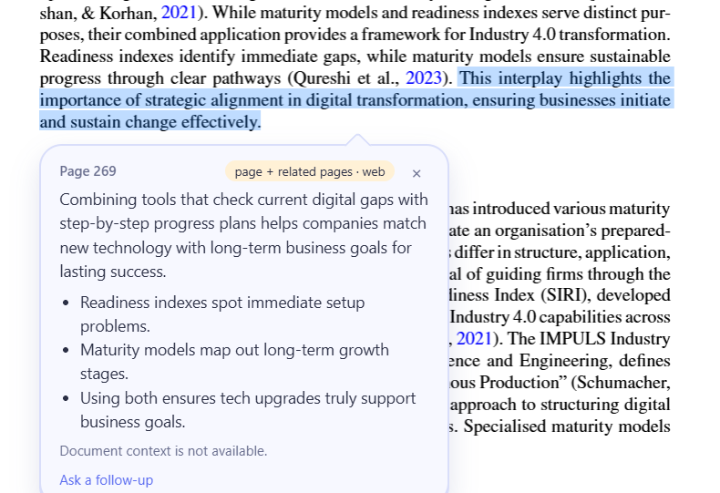

# Doc Explainer

**Understand the difficult part of a PDF without leaving the page.**

Reading a research paper, course material or a technical report? Select an unfamiliar term or a confusing passage, click **Explain**, and get a short explanation beside the text. Ask a follow-up question in the side panel when you need more detail.

A standalone Chrome extension powered by **your own Gemini API key**. No terminal, Ubuntu, Node server or separate application is needed during normal use.

[Install](#install) · [Privacy and API usage](#privacy-and-api-usage)

## See it in action

*Actual screenshot supplied by the author from an earlier build. Labels and layout may differ slightly in this release. This example shows an explanation before a full document summary was available.*

## Made for the moment you get stuck

| When you need to… | Doc Explainer helps you… |
|---|---|
| Understand an unfamiliar term | Explain your selection using the page and available document context |
| Unpack a dense paragraph | Read a short explanation without copying text into another app |
| Ask “what does that mean here?” | Continue the conversation in the side panel |
| Read in another language | Choose from 11 interface and answer languages |
| Find your way through a long PDF | Browse page thumbnails and the PDF's own bookmarks |

Light and dark themes are included. Use **Only document** for document-focused explanations, or **Web assisted** for additional background and Google Search when available to your key. Search availability varies; a web-assisted answer does not necessarily mean a search was performed.

## How to use it

1. **Open a PDF in Chrome.** Local files and online PDFs open in the extension's PDF viewer.
2. **Select text and click Explain.** An explanation appears beside your selection.
3. **Ask a follow-up.** Open the side panel to continue the conversation.

Scrolling does not trigger page-by-page explanation requests. Opening a document with a saved API key does start background reading to build document context; see the privacy note below.

## Install

Chrome 128 or later is required. This repository provides a manual installation; no Chrome Web Store listing is linked yet.

1. On GitHub, choose **Code → Download ZIP**, then extract it to a folder you will keep.
2. Open **chrome://extensions** and enable **Developer mode**.
3. Click **Load unpacked** and select the extracted **chrome-extension** folder.
4. To read local PDFs, open the extension's **Details** and enable **Allow access to file URLs**.
5. Open the extension's side panel → **Settings**, enter your Gemini API key and click **Save**. You can obtain a key from [Google AI Studio](https://aistudio.google.com/apikey).
6. Open a PDF, select a passage, and click **Explain**.

When updating a manual installation, keep the same installation folder and click **Reload** in chrome://extensions, then reload your PDF tab.

## Privacy and API usage

**Your PDFs are processed by Google, not entirely on your device.** While an API key is set, opening a PDF starts sending its extracted text to Gemini in parts to build a summary. Explanations and chat send the selected text or question plus relevant document context. There is no developer-operated backend.

- API use consumes your Google quota and may incur charges. Large PDFs use more tokens.
- The key stays in session storage by default. **Remember on this device** stores it locally, unencrypted, in your Chrome profile; it is not synced to your Google account.
- Document summaries, answers and chat are held for the session and removed when the document's last tab closes. Reopening it later can require processing it again.
- Closing the last PDF tab cancels pending work and aborts active requests locally. A request already received by Google may still be processed and billed.
- Settings such as theme and language can sync through Chrome.
- Only open documents you are comfortable sending to Google under your API account's terms.

Read the [privacy policy](PRIVACY.md) for details.

## What to expect

- **Gemini only in this release.** OpenAI and Anthropic are not included.
- **PDF input.** Export Word documents or slide decks to PDF first.
- PDFs need usable selectable text. Image-only scans may not provide text to explain.
- Protected downloads and unusual PDF layouts may not work as expected.
- AI answers can be wrong. Check important claims against the document and cited sources.
- Document summaries can take time, especially for large files or limited API quotas.

## Feedback

Created by **[Yagmur Karakus](https://github.com/kyagmur1)**.

Use this repository's **Issues** tab for bug reports, feature requests or privacy questions. Never post an API key, a private document or a download link containing an access token. For bugs, include the Chrome version, steps to reproduce and the visible error message.

## License

[MIT](LICENSE). Bundled PDF.js is by Mozilla and retains its [Apache-2.0 license](chrome-extension/vendor/pdfjs/LICENSE).
